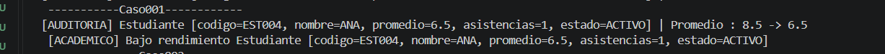
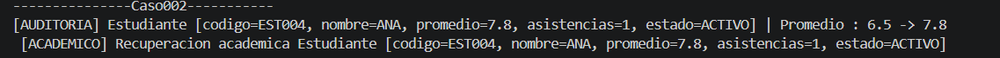
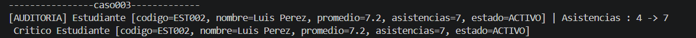
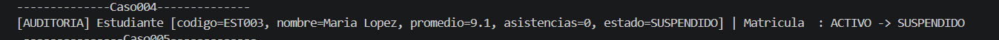
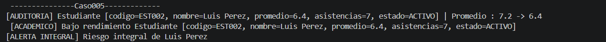
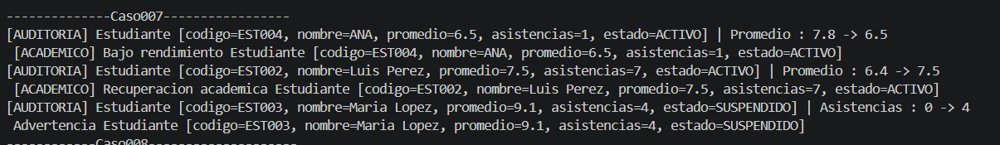
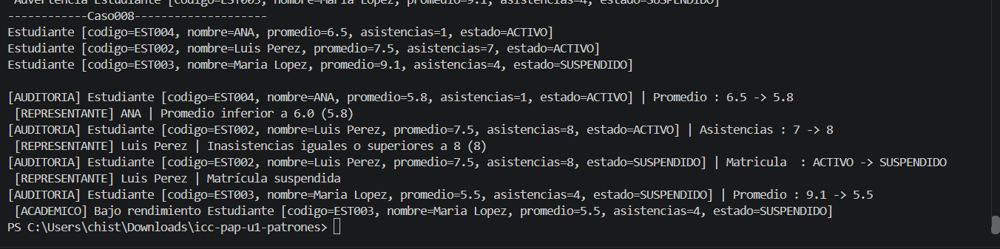

## Casos de prueba del patrón Observer

1. **Bajo rendimiento.** El promedio de Ana baja de `8.5` a `6.5`. La auditoría registra el cambio y el observador académico emite una alerta de bajo rendimiento.

2. **Recuperación académica.** El promedio de Ana sube de `6.5` a `7.8`. La auditoría registra el cambio y el observador académico informa la recuperación.

3. **Asistencia crítica.** Luis pasa de `4` a `7` inasistencias. La auditoría registra el cambio y el control de asistencia emite una alerta por el paso de advertencia a nivel crítico.

4. **Estado de matrícula.** María pasa de `ACTIVO` a `SUSPENDIDO` y luego vuelve a `ACTIVO`. La auditoría registra ambos cambios y el observador de matrícula informa la suspensión y la reactivación.

5. **Riesgo integral.** El promedio de Luis baja de `7.2` a `6.4`. Como ya tiene `7` inasistencias y matrícula activa, se generan las alertas de bajo rendimiento y de riesgo integral.

6. **Valores idénticos.** Se asignan a María los mismos valores que ya tiene. Se generan cero eventos y los observadores permanecen inactivos.

7. **Múltiples estudiantes.** Se modifican los promedios de Ana y Luis y las inasistencias de María. La auditoría identifica a cada estudiante, los observadores responden a los cambios que les corresponden y cada modificación afecta solo al estudiante involucrado.

8. **Aviso al representante.** `NotificadorRepresentante` se suscribe únicamente a Ana y Luis. Emite un aviso por promedio inferior a `6.0`, por `8` o más inasistencias o por un cambio de matrícula a `SUSPENDIDO`. María conserva sus suscripciones previas y queda fuera de los avisos al representante.

