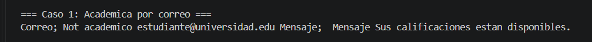
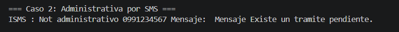
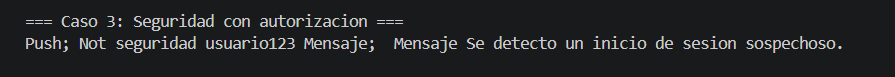
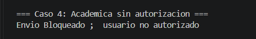
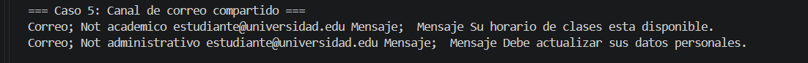
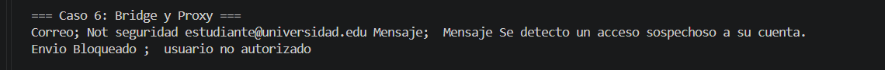

### Pruebas obligatorias
En la clase AppNotificaciones, implementar los siguientes casos. Los estudiantes deberán determinar cómo instanciar y combinar los objetos necesarios.

### Caso 1. Notificación académica por correo electrónico

>Enviar una notificación académica al estudiante estudiante@universidad.edu informando que sus calificaciones están disponibles.

Resultado esperado: el sistema envía el mensaje académico mediante correo electrónico.

### Caso 2. Notificación administrativa por SMS

>Enviar una notificación administrativa al número 0991234567 informando que existe un trámite pendiente.

Resultado esperado: el sistema envía el mensaje administrativo mediante SMS.

### Caso 3. Notificación de seguridad con autorización

>Enviar una alerta de seguridad mediante notificación push a usuario123, utilizando un Proxy con autorización habilitada.

Resultado esperado: el sistema verifica la autorización y permite enviar la alerta.

### Caso 4. Notificación académica sin autorización

>Intentar enviar una notificación académica por SMS al número 0987654321, utilizando un Proxy con autorización deshabilitada.

Resultado esperado: el sistema bloquea el envío. El canal SMS no debe ejecutarse.

### Caso 5. Reutilización del mismo canal con diferentes notificaciones

>Utilizar un mismo objeto CanalCorreo para enviar una notificación académica y otra administrativa.

Resultado esperado: ambas notificaciones se envían correctamente mediante el mismo canal, conservando sus respectivos tipos y mensajes.

### Caso 6. Combinación de Bridge y Proxy con diferentes canales

>Enviar dos notificaciones de seguridad, una mediante correo electrónico y otra mediante SMS. Ambos canales deben estar protegidos por un Proxy, pero únicamente uno debe tener autorización.

Resultado esperado: se realiza únicamente el envío autorizado. El segundo envío se bloquea sin ejecutar el canal real.